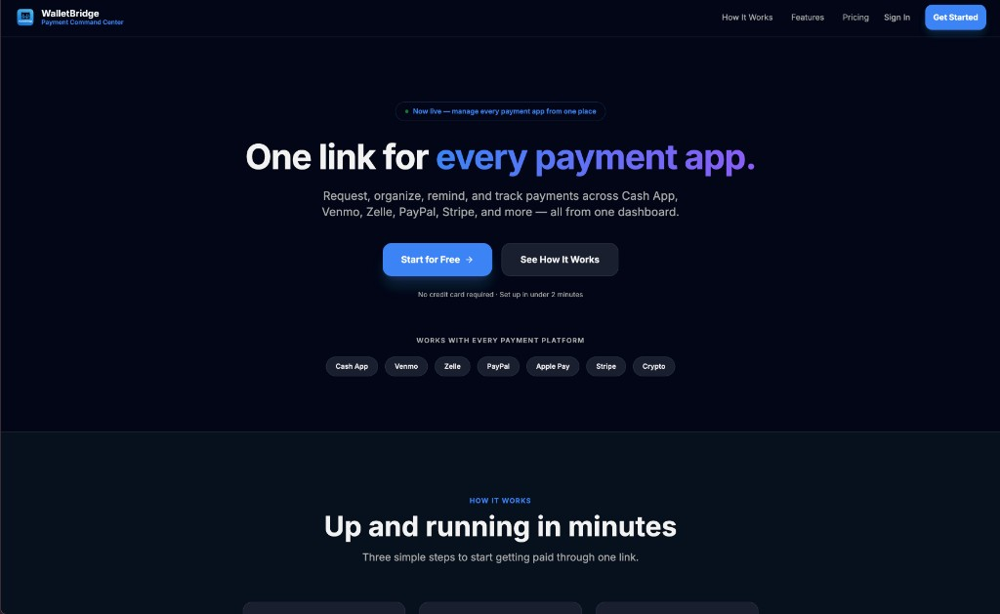
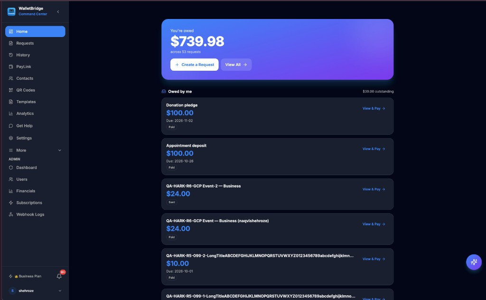
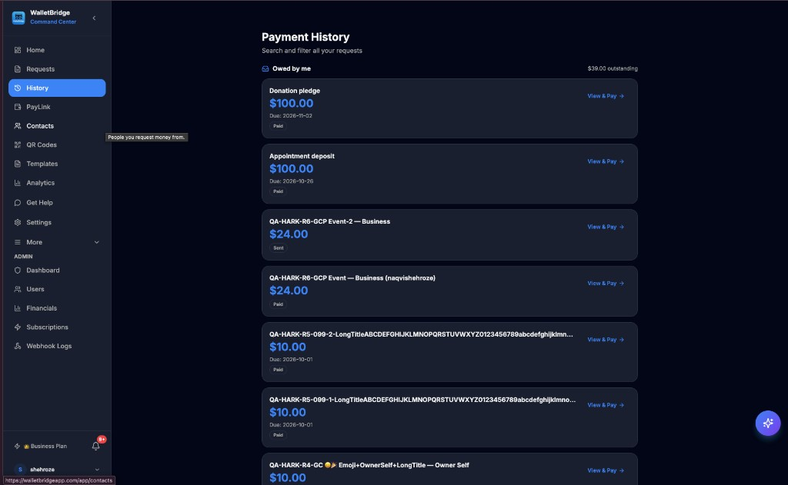
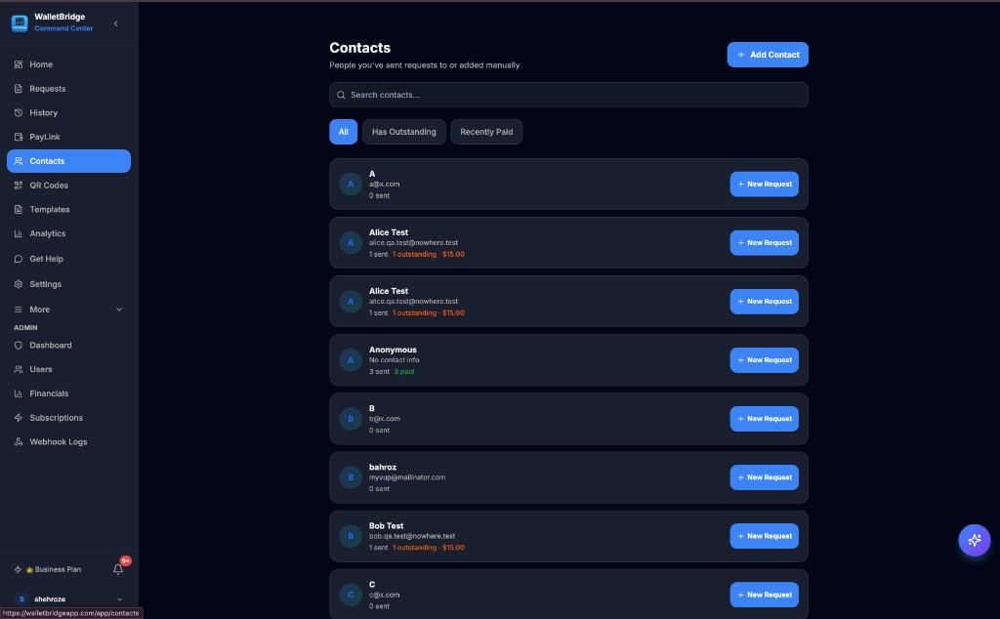
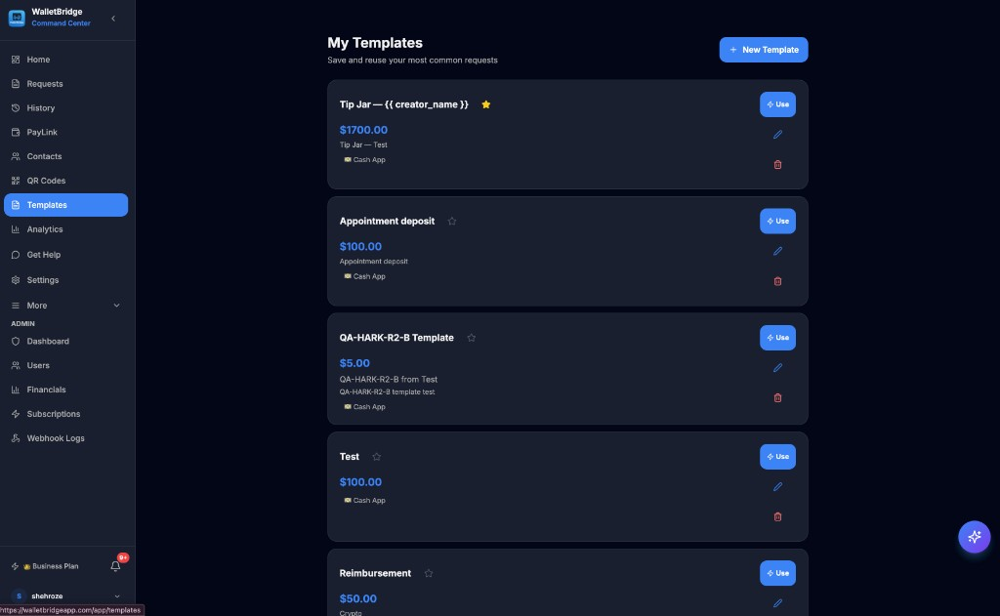
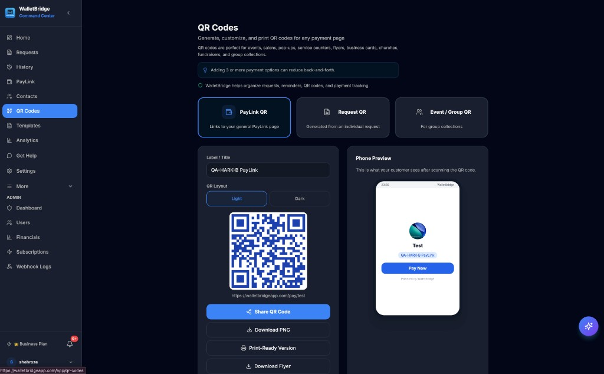
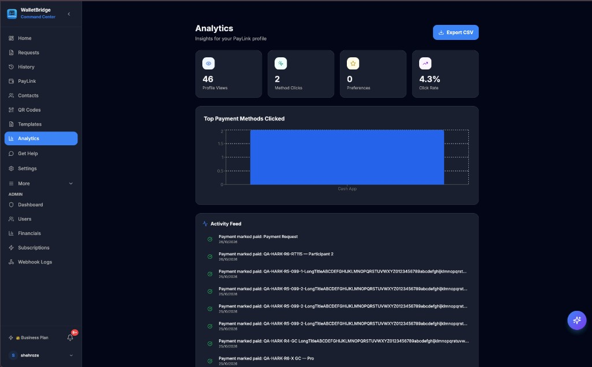
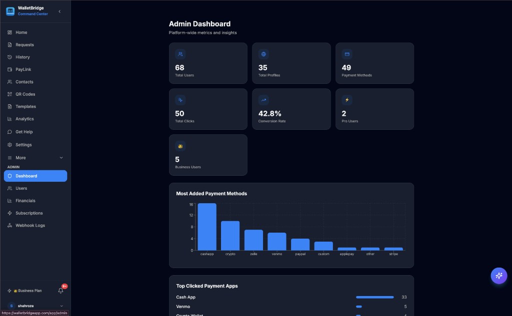
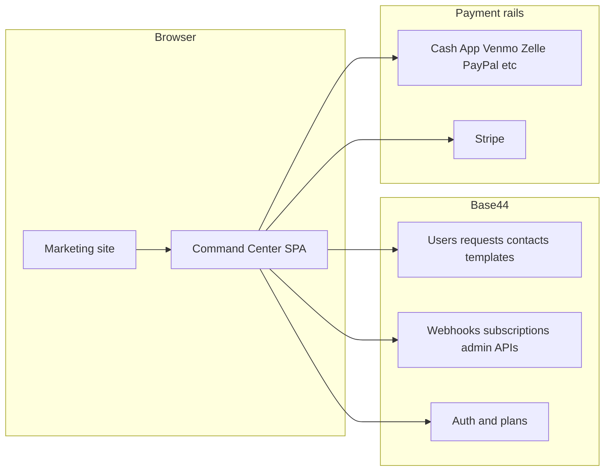

# WalletBridge (Bridge Pay) — Portfolio

> **This public repository is a portfolio showcase only.**  
> Application **source code is private** and is not published here. Browse this page to review product scope, screenshots, and technology. **Contact the owner** for source access or technical due diligence.

**Payment Command Center** — one link and one dashboard to **request, organize, remind, and track** money across the apps people already use (Cash App, Venmo, Zelle, PayPal, Apple Pay, Stripe, crypto, and custom methods).

| | |
|---|---|
| **Live product** | [walletbridgeapp.com](https://walletbridgeapp.com) |
| **Portfolio** | Public accomplishments page (this repo) |
| **Source code** | Private — available on request |
| **Also known as** | Bridge Pay (internal project name) |

---

## Problems WalletBridge solves

People and small businesses juggle **many payment apps** with no single place to send a request, see what’s outstanding, or prove what was paid. WalletBridge centralizes that workflow without forcing payers onto one processor.

| Problem | How WalletBridge helps |
|---------|-------------------------|
| **Fragmented payment apps** | One **PayLink** profile lists every method; payers choose what they already use |
| **Lost requests & awkward follow-ups** | Structured **payment requests** with due dates, status (`Sent` / `Paid`), and history |
| **Repeating the same ask** | **Templates** for tips, deposits, reimbursements, events — one click to reuse |
| **In-person / print payments** | **QR codes** (PayLink, single request, group/event) with PNG, print, and flyer export |
| **Who owes what** | **Home dashboard** and **contacts** with outstanding vs paid rollups |
| **No visibility for growth** | **Analytics** on profile views, method clicks, conversion, CSV export |
| **Operating a SaaS** | **Admin** console: users, financials, subscriptions, webhook logs, platform KPIs |
| **Teams & shared costs** | Group collections, shared expenses, bulk requests, client portal (in full product) |
| **Trust & compliance** | SEO-ready marketing site, structured data, role-based admin guards |

---

## Product highlights

### For payees (creators, freelancers, salons, fundraisers)

- Create and track **payment requests**; see total **owed to you** at a glance  
- **PayLink** public page with all your methods in one place  
- **Contacts** tied to request history and quick “new request” actions  
- **Templates** with variable amounts and multi-method badges  
- **QR toolkit** with live phone preview, light/dark layouts, share & download  
- **Analytics** for PayLink performance (views, clicks, top methods)  
- Plans: free → **Pro** → **Business** with feature gating  

### For platform operators

- **Admin dashboard**: users, profiles, payment methods, clicks, conversion, plan mix  
- **Financials & subscriptions** administration  
- **Webhook logs** for payment and integration debugging  
- Charts for **most added** and **most clicked** payment apps  

### Supported payment platforms (profile / PayLink)

Cash App · Venmo · Zelle · PayPal · Apple Pay · Stripe · Crypto · Custom

---

## Screenshots

### Marketing — one link for every payment app

### Command Center — balance owed and quick actions

### Payment history — search, filter, and statuses

### Contacts — per-person sent, outstanding, and paid totals

### Templates — reusable request presets

### QR codes — generate, preview, print, and share

### Analytics — PayLink insights and activity feed

### Admin — platform-wide metrics

---

## Technology stack (private codebase)

### Frontend

| Technology | Role |
|------------|------|
| **React 18** | SPA UI, lazy-loaded routes, app shell |
| **Vite 6** | Build tool and dev server |
| **React Router 6** | Marketing site + authenticated `/app` workspace |
| **TanStack Query** | Server state and caching |
| **Tailwind CSS 3** | Dark-first UI, responsive layouts |
| **Radix UI + shadcn patterns** | Accessible dialogs, sidebar, forms, charts |
| **Framer Motion** | Motion and transitions |
| **React Hook Form + Zod** | Validated flows (onboarding, requests, settings) |
| **Recharts** | Admin and analytics visualizations |
| **Lucide React** | Icon system |

### Payments & platform

| Technology | Role |
|------------|------|
| **Stripe** (`@stripe/react-stripe-js`) | Subscriptions and card flows where integrated |
| **Multi-rail pay links** | Cash App, Venmo, Zelle, PayPal, crypto, etc. on profiles and requests |
| **Base44** (`@base44/sdk`, Vite plugin) | Backend entities, functions, auth, email, hosting |
| **TypeScript** | Shared logic in `base44/` where applicable |

### Product engineering

- **Role-based access**: user app vs `AdminGuard` routes  
- **Feature gating** by plan (Pro / Business)  
- **Webhook log viewer** for operators  
- **PWA-oriented** assets (`manifest.json`, mobile viewport)  
- **SEO**: Open Graph, Twitter cards, JSON-LD on marketing pages  

### QA (separate public tooling repo)

End-to-end **Playwright** QA automation for WalletBridge lives at [github.com/Shehroz-Ali/walletbridge](https://github.com/Shehroz-Ali/walletbridge) (test suite only — not application source).

---

## Architecture (high level)

---

## Scope at a glance

- **~500** source and configuration files in the private repository  
- Full **command center**: requests, history, PayLink, contacts, QR, templates, analytics, settings, team, shared expenses, receipt tooling, and more  
- **Admin suite** for operating the product as a SaaS  
- Production domain: **walletbridgeapp.com**

---

## Contact

**Repository owner:** [Shehroz-Ali](https://github.com/Shehroz-Ali)  
Demos, source access, and partnership inquiries by request only.

**License:** Proprietary. Screenshots and this overview may be used for portfolio review; code is not licensed for redistribution.